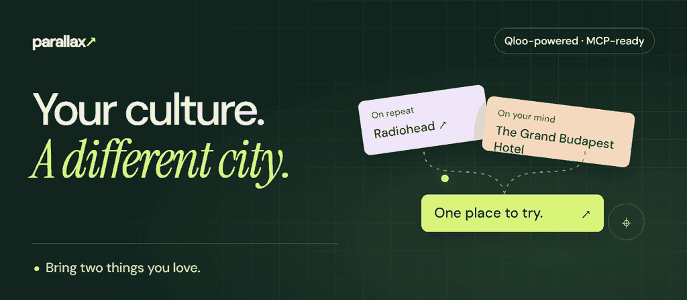
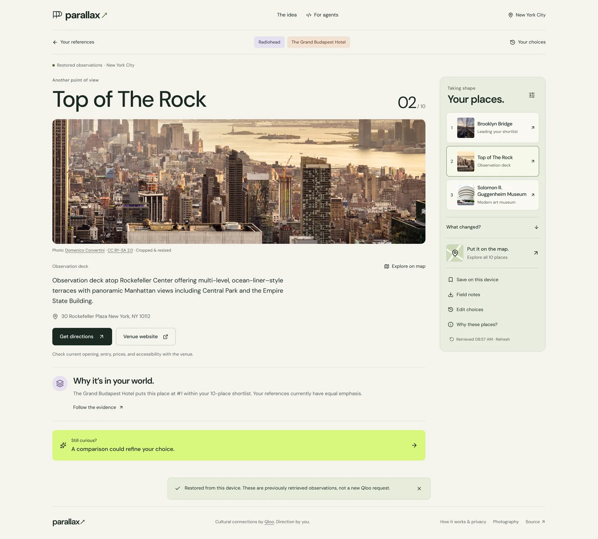
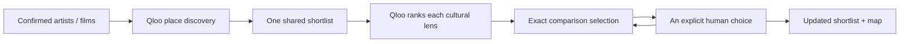

<p align="center">
  <a href="https://parallax-culture.vercel.app">
    <picture>
      <source media="(prefers-reduced-motion: reduce)" srcset="docs/assets/parallax-cover.png">
      
    </picture>
  </a>
</p>

<p align="center">
  <strong>A Qloo-powered agentic tool for choosing one place to try.</strong><br>
  <a href="https://parallax-culture.vercel.app">Open the studio ↗</a> ·
  <a href="docs/DEMO.md">Try the workflow</a> ·
  <a href="docs/AGENT.md">Connect an agent</a> ·
  <a href="docs/VERIFICATION.md">Inspect the evidence</a>
</p>

<p align="center">
  <a href="https://github.com/kathir-iTech/parallax/actions/workflows/verify.yml"></a>
  &nbsp; <a href="LICENSE">MIT source</a> &nbsp;·&nbsp; <a href="docs/assets/parallax-cover.png">Still cover</a>
</p>

## A favorite artist. A film that stays with you. Where next?

You know what you love. You may not know which New York place to try.

PARALLAX turns two or three familiar artists or films into one shared shortlist. Qloo discovers places and ranks that same shortlist through each cultural reference. When those perspectives disagree, an exact decision model selects a comparison that could help you choose.

**Your answer can change the recommendation. Removing it rebuilds the decision.**



_Actual studio capture using restored Qloo observations. Header animation is an original workflow illustration. Venue-photo credits remain visible in the studio and are documented in [attribution](docs/ATTRIBUTION.md)._

## Follow one decision

| Bring                                                                             | Compare                                                               | Choose                                                                              |
| :-------------------------------------------------------------------------------- | :-------------------------------------------------------------------- | :---------------------------------------------------------------------------------- |
| Confirm two artists or films. Qloo supplies cultural associations across domains. | Answer a useful A/B question. Both, neither and skip remain distinct. | Inspect a place, explore the city map, correct an answer, or save your preferences. |

Try **Radiohead × Grand Budapest** in the [live studio](https://parallax-culture.vercel.app). Choose **Find my places**, answer a comparison, then open **1 choice** beside the history icon and remove that answer. Inspect what changes. No login, purchase or judge-supplied API key is needed for the hosted studio. [Exact walkthrough →](docs/DEMO.md)

## Qloo is the foundation



Qloo provides both discovery and reference-conditioned rankings. Without those inputs, this workflow cannot prepare its culturally grounded candidate set. The adapter preserves the official discovery and supplied-shortlist contracts; it does not claim to execute the native Qloo harness.

- **One common set:** at most ten place identities, with coordinates in the supported New York area and coverage under every cultural lens. Missing ranks stay missing.
- **A question with a purpose:** a finite preference model evaluates expected reduction in modeled decision regret. Up to three relative choices; it can stop earlier.
- **A decision you can correct:** answers are recomputed from a clean prior when changed or removed. Neither creates reversible current-outing vetoes; both and skip invent no relative preference.
- **A complete studio:** comparisons, animated shortlist, before/after view, map, evidence, local preferences, field notes, and responsive licensed photography.

[Decision methodology](docs/METHODOLOGY.md) · [Experience design](docs/EXPERIENCE.md) · [Photography](docs/PHOTOGRAPHY.md)

## Give an agent the same tool

The `parallax_advise` MCP tool exposes `resolve`, `prepare`, `advise` and `forget` over one local stdio bridge to the public HTTPS backend. An assistant can obtain a comparison and ask the person to answer it. Supplied answers use the same decision engine as the studio.

After installing dependencies, run a real protocol demonstration:

```sh
npm run demo:agent
```

It confirms declared sample identities through Qloo, prepares a shared shortlist, applies a **scripted demonstration answer**, removes it, verifies the original decision is restored, and forgets temporary evidence. No key is printed or required by the public tool user. This is an actual MCP client invocation; **no LLM is invoked by this demonstration**. It consumes the public service's finite provider allowance.

[Connect your MCP client →](docs/AGENT.md)

## Run locally

Node **24.x** and the committed npm lockfile are required. Self-hosting needs your own authorized Qloo credential, a Postgres database, and a random session secret. The hosted studio already has its own configured backend.

```sh
npm ci
cp .env.example .env.local
# Set QLOO_API_KEY (or QLOO_KEY_FILE), SESSION_SECRET and DATABASE_URL privately.
# Apply server/migration.sql to your dedicated Postgres database.
npm run dev
```

Open the URL printed by the server. Credentials stay on the server. [Configuration, database setup and quotas →](docs/OPERATIONS.md)

## Evidence you can reproduce

```sh
npm test                 # Decision, HTTP and photographic-asset checks
npm run evaluate         # Seeded synthetic comparisons; not a human study
npm run build            # TypeScript + production client
npx playwright install chromium
npm run test:browser     # Actual UI + MapLibre with synthetic API fixtures
```

| Evidence                    | What it establishes                                                                                     |
| :-------------------------- | :------------------------------------------------------------------------------------------------------ |
| 18 unit/HTTP/asset tests    | Independent decision oracle, answer semantics, scoped API boundaries, and 89 decodable image editions   |
| 8 browser cases             | Comparison/undo, save/restore, map control and recovery, mobile/retina photography, motion and contrast |
| 1,600 synthetic executions  | Declared policies and preference generators, including unfavorable comparisons and model mismatch       |
| Deployed integration checks | Actual Qloo retrieval, browser flow, and MCP protocol behavior; recorded separately from fixtures       |

The [verification record](docs/VERIFICATION.md) states the scope and limits. Synthetic results do not establish human enjoyment or universal recommendation superiority. Automated accessibility checks are not a full accessibility certification.

## Inside the repository

| Path                                | Responsibility                                                              |
| :---------------------------------- | :-------------------------------------------------------------------------- |
| [`src/`](src/)                      | React studio, MapLibre explorer, local preferences, photo catalog           |
| [`core/`](core/)                    | Pure TypeScript model, exact comparison selection, stop rules               |
| [`server/`](server/)                | Qloo adapter, signed sessions, input validation, atomic shared quota ledger |
| [`agent/`](agent/)                  | MCP stdio bridge to the public HTTPS backend                                |
| [`tests/`](tests/) · [`e2e/`](e2e/) | Decision, API, asset and browser verification                               |
| [`docs/`](docs/)                    | Methodology, operation, evaluation, integration and attribution             |

## Boundaries that matter

The first edition helps someone choose **one New York place to try**. Cultural association does not certify enjoyment, opening hours, entry conditions, accessibility or safety. The studio does not book venues or infer sensitive traits.

Studio preferences stay in IndexedDB on the person's device. The MCP bridge transmits explicitly supplied answers for transient backend computation; it creates no remote personal profile. Session-scoped provider evidence expires after thirty minutes. Exported preferences exclude credentials and bulk provider content.

Runtime operation requires no mandatory generative model, paid map API, or image subscription. Provider grants and free-service allowances remain finite. Unknown or ambiguous venues keep their Qloo ranking and receive an explicit photo placeholder. [Privacy and operation →](docs/OPERATIONS.md)

## License

Application source: [MIT](LICENSE), Kathirvel R. Third-party photography, fonts, map software, map data, and Qloo content retain their individual licenses and terms. [Attribution and rights →](docs/ATTRIBUTION.md)
